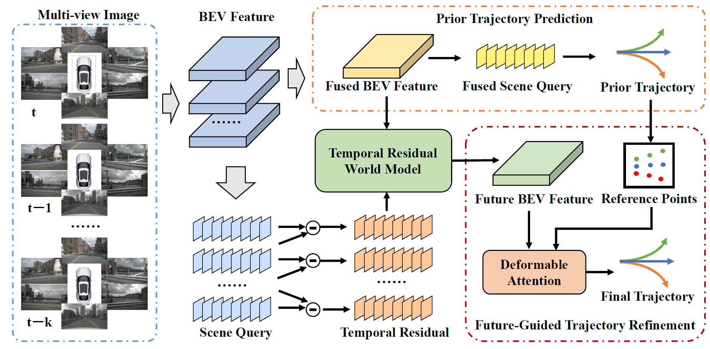

<div align="center">
<h1>SAWorld</h1>
<h3></h3>
</div>

<!-- <div align="center">
  
</div><br/> -->

## Main Results

### UniAD-style metrics
| Method | L2<sub>MAX</sub> (m) 1s | L2<sub>MAX</sub> (m) 2s | L2<sub>MAX</sub> (m) 3s | L2<sub>MAX</sub> (m) Avg. | CR<sub>MAX</sub> (%) 1s | CR<sub>MAX</sub> (%) 2s | CR<sub>MAX</sub> (%) 3s | CR<sub>MAX</sub> (%) Avg. | 
| --- | --- | --- | --- | --- | --- | --- | --- | --- |
| SAWorld | 0.19 | 0.52 | 1.15 | 0.62 | 0.02 | 0.12 | 0.63 | 0.26 | 

### VAD-style metrics
| Method | L2<sub>AVG</sub> (m) 1s | L2<sub>AVG</sub> (m) 2s | L2<sub>AVG</sub> (m) 3s | L2<sub>AVG</sub> (m) Avg. | CR<sub>AVG</sub> (%) 1s | CR<sub>AVG</sub> (%) 2s | CR<sub>AVG</sub> (%) 3s | CR<sub>AVG</sub> (%) Avg. |
| --- | --- | --- | --- | --- | --- | --- | --- | --- |
| SAWorld | 0.14 | 0.28 | 0.51 | 0.31 | 0.01 | 0.05| 0.18 | 0.08 |
-------------- Planning --------------
plan_L2_1s:0.140407326381614
plan_L2_2s:0.2823010440468435
plan_L2_3s:0.5124106111912341
plan_obj_col_1s:0.0
plan_obj_col_2s:0.0
plan_obj_col_3s:6.511688674886516e-05
plan_obj_box_col_1s:9.767532721234616e-05
plan_obj_box_col_2s:0.0004883766360617308
plan_obj_box_col_3s:0.0017581559334865049
fut_valid_flag:1.0
plan_L2_stp3_1s:0.18695982903635136
plan_obj_col_stp3_1s:0.0
plan_obj_box_col_stp3_1s:0.0001953506544246923
plan_L2_stp3_2s:0.5238003788540723
plan_obj_col_stp3_2s:0.0
plan_obj_box_col_stp3_2s:0.001172103926548154
plan_L2_stp3_3s:1.147482585924912
plan_obj_col_stp3_3s:0.0001953506544246923
plan_obj_box_col_stp3_3s:0.006251220941590154
## Get Started

#### 1. Please follow these steps to install ResWorld.

a. Create a conda virtual environment and activate it.
```shell
conda create -n saworld python=3.10 -y
conda activate saworld
```

b. Install PyTorch and torchvision following the [official instructions](https://pytorch.org/).
```shell

pip install torch==2.6.0+cu126 torchvision==0.21.0+cu126 2.6.0+cu126 -f https://download.pytorch.org/whl/torch_stable.html
```

c. Install mmcv-full, mmdet and mmseg.
```shell
mmcls                      0.25.0
mmcv                       1.7.1
mmcv-full                  1.7.1                /root/mmcv-1.7.1
mmdet                      2.28.2
mmdet3d                    1.0.0rc6             /root/mmdetection3d-1.0.0rc6
mmdet3d-plugin-ops         0.0.0                /xs-train-nas/LingXiTeam/workspace/cxy/lingxiagent_0530/lingxiagent/projects/mmdet3d_plugin/ops
mmsegmentation             0.30.0
```

d. Install nuscenes-devkit.
```shell
pip install nuscenes-devkit            1.1.10
```

#### 2. Prepare nuScenes dataset as the below folder structure:

```
GeoBEV
├── data
│   ├── nuscenes
│   │   ├── lidarseg
│   │   ├── maps
│   │   ├── samples
│   │   ├── samples_point_label
│   │   ├── sweeps
│   │   ├── v1.0-test
|   |   ├── v1.0-trainval
│   │   ├── vad_nuscenes_infos_temporal_train.pkl
│   │   ├── vad_nuscenes_infos_temporal_val.pkl
```
a. Download nuScenes 3D detection data [HERE](https://www.nuscenes.org/download) and unzip all zip files.


b. Download the [train](https://drive.google.com/file/d/1OVd6Rw2wYjT_ylihCixzF6_olrAQsctx/view?usp=sharing) file and [val](https://drive.google.com/file/d/16DZeA-iepMCaeyi57XSXL3vYyhrOQI9S/view?usp=sharing) file generated by VAD.


c. Download nuScenes-lidarseg annotations [HERE](https://www.nuscenes.org/download) and put it under `data/nuscenes/`. Create depth label utilized by GeoBEV from point cloud by running:
```shell
python tools/generate_point_label.py
```

#### 3. Train SAWorld model on nuScenes:
Download the backbones pretrained by GeoBEV [HERE](https://drive.google.com/file/d/1B8Bz4_CpHGjgBrD84JbBJrAtx4TOnUG0/view?usp=sharing) and put it under `ckpts/`. Then train the SAWorld model following:
```shell
# Run from the SAWorld directory.
bash tools/dist_train.sh projects/configs/saworld/saworld_config.py 8
```
The training launcher defaults to `/xs-train-nas/workspace_cpw/conda/wam_cpw/bin/python`. Set `PYTHON=/path/to/python` to use another environment.

The training config uses eight data workers per GPU and `data.persistent_workers=True` for both training and validation. Workers are initialized on the first pass and reused on subsequent epochs; distributed sampling still reshuffles each training epoch. Setting `data.workers_per_gpu=0` automatically disables worker persistence. `data.workers_per_gpu` controls CPU data loading parallelism; `data.samples_per_gpu` controls the batch size and is the main setting for GPU memory use. Restart training to apply changes to these settings.

#### 4. Evaluate ResWorld model following:
```shell
 bash tools/dist_test.sh work_dirs/saworld_config/saworld_config.py work_dirs/saworld_config/epoch_12_ema.pth 8 --eval bbox
```
The model after training is available [HERE](https://drive.google.com/file/d/12mlspkNBLhMrwpRZJGlC4hfWU07Yt9V9/view?usp=sharing).

## Acknowledgement

This project is not possible without multiple great open-sourced code bases. We list some notable examples below.

- [BEVDet](https://github.com/HuangJunJie2017/BEVDet)
- [VAD](https://github.com/hustvl/VAD)
- [SSR](https://github.com/PeidongLi/SSR)
