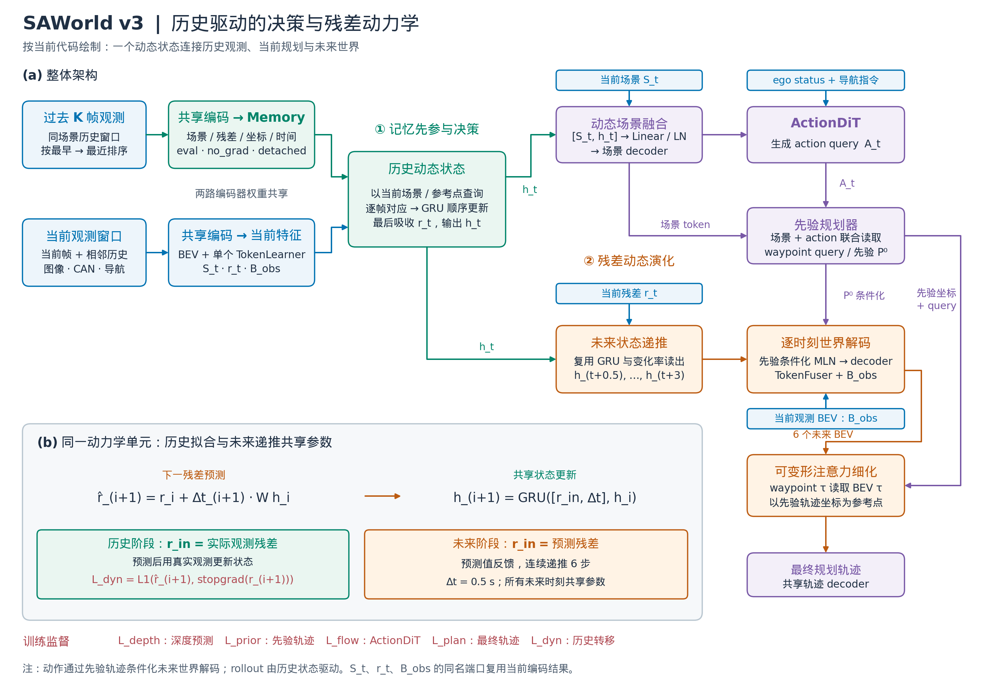

# SAWorld V3：用同一个残差动态状态连接历史、决策与未来

V3 针对两个结构问题：历史只在先验规划完成后起作用，以及历史残差被当作无序补偿量读取。新结构为：



[可编辑 Draw.io 图源](figures/saworld_v3_architecture.drawio) · [SVG 矢量图](figures/saworld_v3_architecture.svg)

图：同一个残差动态状态同时参与当前 action / 先验规划，并驱动六个未来时刻的世界预测。历史阶段以已观测残差拟合转移；未来阶段反馈预测残差，并复用相同的状态更新参数。先验轨迹条件化未来世界的解码，各 waypoint 通过可变形注意力读取对应时刻的 BEV。


## 一个动态状态，两个用途

当前场景和残差使用同一个 TokenLearner 的区域权重。历史场景作为 key，历史残差作为 value，按每个历史时间点分别建立与当前区域的软对应。注意力只用于对应关系，不把 K 个时间点混合成一个平均向量；value 保持原残差特征空间。历史参考点通过自车位姿变换到当前坐标系。

令 r_i 为对应后的观测残差，dt_i 为相邻有效观测的秒数，状态更新为：

```text
h_i = GRU([r_i, dt_i], h_(i-1))
S_dynamic = LayerNorm(Linear([S_current, h_t]))
```

历史按最早到最近顺序更新，最后吸收当前残差。缺少历史时只处理当前观测，不填充重复历史。S_dynamic 先经过场景 decoder，然后生成 action 与先验轨迹；prior planning loss 和 action flow loss 都能训练历史读取及状态更新。

## 共享动力学预测下一残差，再递推未来

GRU 状态估计残差的变化率：

```text
rate_i = Linear(h_i)
r_hat_(i+1) = r_i + dt_(i+1) * rate_i
```

处理历史时，用预测 r_hat_(i+1) 与实际已观测残差 r_(i+1) 的 L1 误差训练这个预测器，再用真实 r_(i+1) 更新 GRU。预测未来时，实际观测不可用，因此将 r_hat_(i+1) 反馈给同一个 GRU，连续递推六次，每次 0.5 秒。

这里的 rate 是**特征残差的时间变化率**，不是车辆物理速度或加速度；线性读出作用于非线性 GRU 状态，不是固定直线外推。时间间隔直接参与状态更新和预测步长。

每个未来状态分别经过原有的轨迹条件化 MLN、残差 decoder 和 TokenFuser，得到该时刻的预测 BEV。所有时刻共享同一套参数。每个 waypoint 只读取对应时刻的 BEV，以其先验累计坐标为可变形注意力的参考点。无需额外的轨迹门控。

环境残差递推本身由历史状态驱动；动作通过先验轨迹条件化未来世界的解码。它不是一个已经验证的反事实交互模型。

## 监督与数据协议

总共五项 loss：原有 depth、prior planning、final planning、action flow，加一个 `loss_memory_dynamics`（默认权重 1.0）。新增项为有效相邻观测之间的残差预测 L1，target 使用 stop-gradient，按有效转移数归一化。没有有效历史转移时该项为零。

历史匹配采用当前观测建立的区域坐标系，因此该辅助项是对已观测历史的转移拟合，不应报告成真正的未来 BEV 预测精度。它不读取当前时刻之后的图像、场景标签或专家轨迹。未来六步仍由规划监督训练。

复用 `SAWorldMemoryNuScenesDataset` 与 `SAWorldV2` 的样本内历史构建接口：随机当前帧、原过滤规则、同场景过去 K 帧、历史 eval/no_grad 编码、无跨 batch 缓存。新 head 独立实现，不 import 或继承旧 head。

## 使用与比较

从 `SAWorld` 目录启动：

```bash
bash tools/dist_train.sh projects/configs/saworld/saworld_config_v3_dynamics.py 8
```

输出目录为 `work_dirs/saworld_v3_residual_dynamics`。配置保持 batch=16、8 workers、lr=6e-4、12 epoch、原 GeoBEV 初始化。v2 head、配置和 checkpoint 对应的实现保持独立；v3 应按新架构训练，不用 v2 checkpoint 恢复训练。

核心实现位于 `projects/mmdet3d_plugin/saworld/saworld_head_v3.py`：

- `ResidualDynamics`：共享状态更新、变化率预测和未来递推。
- `read_history` / `encode_dynamics`：逐帧对应、按真实时间处理观测序列、计算历史转移监督。
- `forward`：在 action 与先验之前构建动态场景状态。
- `refine_waypoints`：未来时刻和 waypoint 一一对应的可变形注意力。

验证命令：

```bash
/xs-train-nas/workspace_cpw/conda/wam_cpw/bin/python -m unittest discover -s tests -p 'test_saworld_*.py' -v
```

本次验证：7 项 v3 行为测试和 10 项原 v2 回归测试通过。使用 GeoBEV 初始化，对真实训练样本 100、0 完成单卡 batch=2 的 CUDA 前向/反向，历史长度分别为 4、0；五项 loss 有限、所有可训练参数都有有限梯度，历史编码保持 detached 且不更新 BN 统计。记录在 `work_dirs/saworld_v3_dynamics_validation/smoke.json`。这项检查没有执行优化器更新或完整训练，不能据此判断规划指标提升。

建议先使用同样训练设置比较 v2/v3；在 v3 内用 K=0 检查历史的贡献，用 `dynamics_loss_weight=0` 检查转移监督的贡献。K=0 需要同步设置 head 和 train/val/test 数据集的 `memory_frames`。K=0 仍保留当前残差状态与未来递推，因此它不是原 SAWorld 基线。

## 边界

软对应只利用区域内容与参考点，不保证对象身份一致；递推未来会累积误差。这是当前模型接受的简化。历史仍需重复编码，未来还需六次共享世界解码，计算量会增加；本次改动目标是验证动态记忆的效果，性能与成本需要实测。
